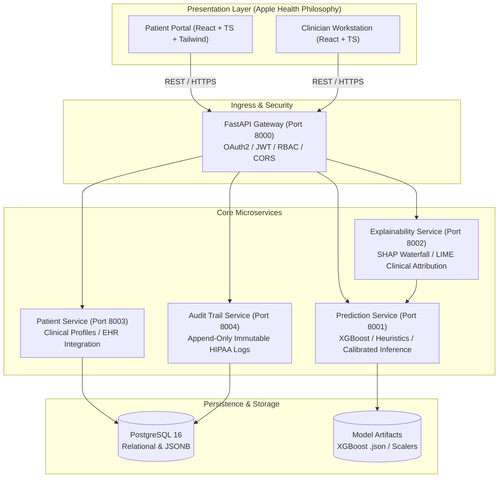

# Diabetes Prediction Intelligence System (DPIS)
## System Architecture Specification

### 1. High-Level Architecture Overview

The **Diabetes Prediction Intelligence System (DPIS)** is built on an enterprise-grade Microservices Architecture tailored for medical compliance, low-latency clinical inference, and transparent decision support.

---

### 2. Microservice Responsibilities

| Service | Port | Primary Tech | Role & Clinical Responsibility |
|---|---|---|---|
| **API Gateway** | 8000 | FastAPI, Python 3.11 | Unified entrypoint, rate limiting, JWT authentication, request routing, role authorization |
| **Prediction Service** | 8001 | XGBoost, scikit-learn | Multi-type diabetes prediction (T2DM, T1DM, GDM, MODY), feature normalization, heuristic fallback |
| **Explainability Service** | 8002 | SHAP, LIME | Generates localized feature attributions, waterfall plots, and plain-language summaries |
| **Patient Service** | 8003 | SQLAlchemy, PostgreSQL | Patient demographic, biometric and glycemic profile management |
| **Audit Service** | 8004 | PostgreSQL (Append-only) | Immutable HIPAA/GDPR audit logging for all PHI transactions |

---

### 3. Data Flow

1. **Patient Data Submission**:
   - The user inputs demographics and biomarkers via the 7-field progressive form.
   - The frontend validates values and calculates body mass index (BMI) in real time.
2. **Gateway Processing**:
   - The API Gateway authenticates the token and verifies the caller's role.
   - An audit trail record (`GENERATE_PREDICTION`) is triggered.
3. **Inference Execution**:
   - The `Prediction Service` applies normalization, categorical encoding, and runs the calibrated XGBoost model.
   - If model binaries are not yet compiled, the medically grounded heuristic engine produces standardized scores according to ADA 2024 benchmarks.
4. **Explainability Computation**:
   - The `Explainability Service` calculates local SHAP additive attributions relative to baseline expected prior $E[f(x)]$.
   - LIME translates statistical outputs into clinical sentences (e.g., HbA1c elevation consequences).
5. **Client Presentation**:
   - The **Patient Portal** displays natural language summaries, an estimated metabolic health age, and the What-If interactive slider.
   - The **Clinician Dashboard** receives a comprehensive single-page flow featuring the full SHAP waterfall and treatment simulation engine.

